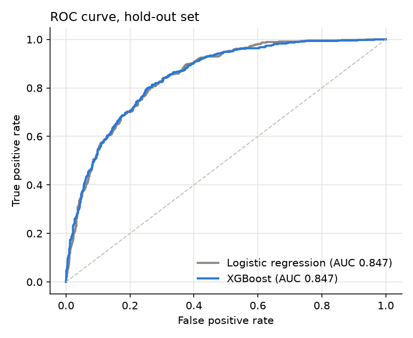
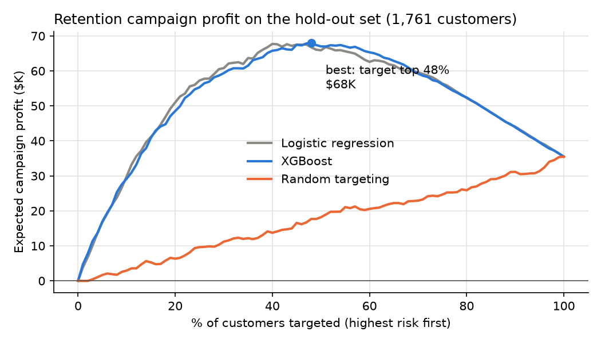

# Customer Churn Prediction → Retention Campaign Sizing


Predict which telecom customers will leave, then answer the question a marketing team actually has:
**how many customers should we send a retention offer to?**

Data: [IBM Telco Customer Churn](https://github.com/IBM/telco-customer-churn-on-icp4d) — 7,043 customers,
26.5% churned. Downloaded automatically on first run.

## Results

| Model | CV ROC-AUC | CV PR-AUC | Hold-out ROC-AUC | Hold-out PR-AUC |
|---|---|---|---|---|
| Logistic regression | 0.844 | 0.657 | 0.847 | 0.638 |
| XGBoost | 0.846 | 0.668 | 0.847 | 0.657 |

5-fold stratified cross-validation on 75% of customers; the remaining 25% is a hold-out set scored once.

**The two models rank customers almost equally well.** The simpler, explainable logistic regression is
a reasonable production choice here; XGBoost adds little.

**What drives churn** (logistic-regression coefficients): short tenure, month-to-month contracts,
fiber-optic internet, paperless billing and electronic-check payment raise churn risk; two-year contracts
and longer tenure lower it.



### From scores to a decision

A retention offer costs money, so contacting everyone is not optimal. Ranking hold-out customers by
predicted risk and assuming a **$50 offer**, a **30% save rate** and **12 months of revenue kept**
per saved customer:

| Strategy | Customers targeted | Expected profit |
|---|---|---|
| XGBoost — target top 48% | 845 | **$67,965** |
| Logistic regression — target top 40% | 704 | $67,719 |
| Offer to everyone | 1,761 | $35,485 |

Targeting by model score **roughly doubles campaign profit** versus contacting everyone, while
contacting about half as many customers.



The assumptions are parameters (`churn/business.py → Campaign`), so the curve can be redone with a
company's own offer cost and save rate. Profit is an expected value under these assumptions, not a
measured result — a real campaign should be validated with a holdout A/B test.

## Run it

```bash
pip install -r requirements.txt
python run_analysis.py   # prints all tables above, writes figures/
pytest -q
```

## Project layout

```
churn/data.py       download + clean (TotalCharges blanks for new customers set to 0)
churn/models.py     shared preprocessing, logistic regression, XGBoost, CV and hold-out evaluation
churn/business.py   profit curve for a retention campaign
run_analysis.py     reproduces every number and figure in this README
tests/              unit tests for the profit logic
```
